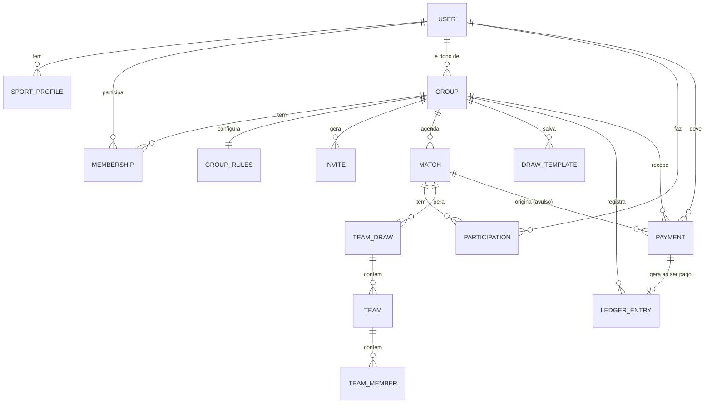
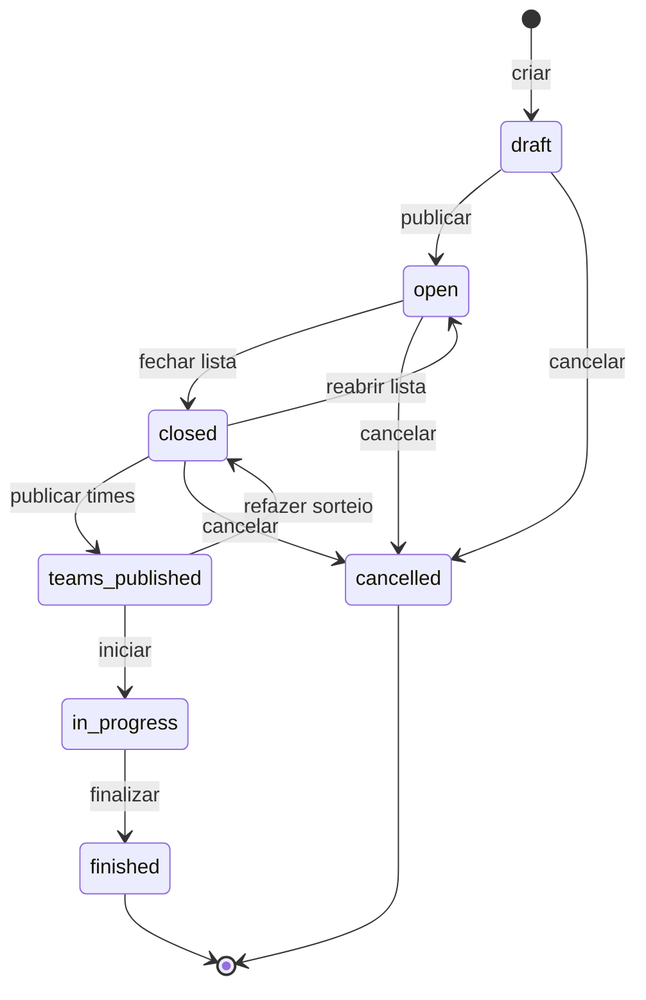
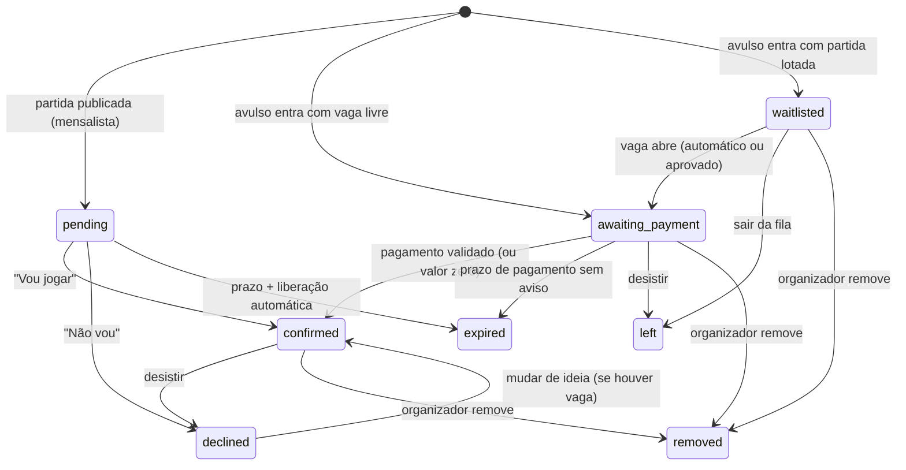
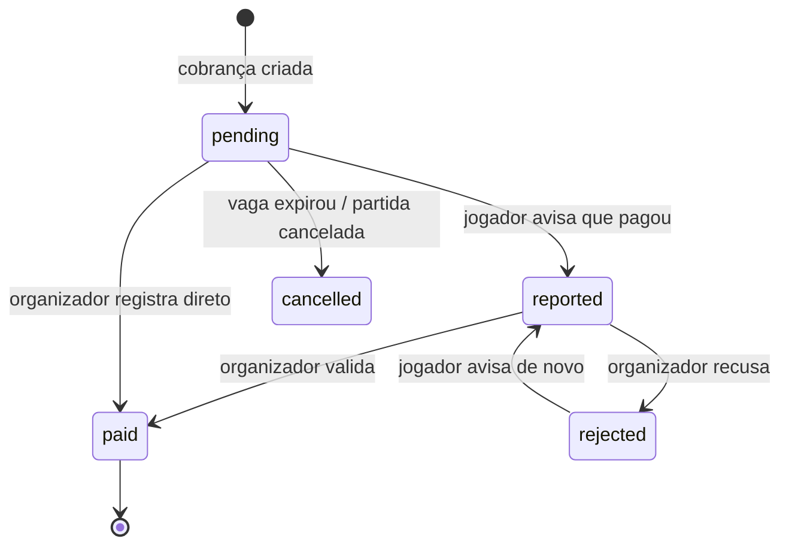

# Modelo de domínio — Dá Jogo

Descrição **independente de tecnologia** das entidades, relacionamentos e estados do MVP. Qualquer stack de back-end (relacional ou não) deve conseguir implementar a partir daqui. As regras que movem os estados estão em [business-rules.md](./business-rules.md); o contrato HTTP está em [../api/openapi.yaml](../api/openapi.yaml).

## Convenções

| Tema | Convenção |
| --- | --- |
| Identificadores | Strings opacas (ex.: UUID v7 ou ULID). O front nunca deduz nada do formato. |
| Datas e horas | ISO 8601 com fuso (`2026-09-24T20:00:00-03:00`). Cada turma tem `timezone` (padrão `America/Sao_Paulo`); prazos são calculados nesse fuso. |
| Dinheiro | Inteiro em **centavos** + moeda (`BRL`). Nunca ponto flutuante. |
| Telefone | E.164 (`+5521998765432`). |
| Textos | Nicknames comparados sem diferenciar maiúsculas/minúsculas e acentos. |
| Exclusão | Entidades com histórico são arquivadas/anonimizadas, não apagadas (ver LGPD em business-rules). |
| Auditoria | Toda entidade tem `createdAt` e `updatedAt`; mudanças de estado relevantes guardam quem fez (`…By`) e quando (`…At`). |

## Visão geral

## Entidades

### Sport (catálogo)
Configuração estática, versionada no código ou em tabela de referência. Permite novas modalidades sem mudar o modelo.

| Campo | Tipo | Notas |
| --- | --- | --- |
| `id` | string | `volleyball` no MVP |
| `name` | string | "Vôlei" |
| `positions` | lista de `{id, label, short}` | Vôlei: `setter` Levantador(a) LEV, `outside` Ponteiro(a) PON, `opposite` Oposto(a) OPO, `middle` Central CEN, `libero` Líbero LÍB |
| `levels` | lista de `{value, label}` | 1 a 5 (a confirmar: ver pendências) |
| `defaultTeamSize` | inteiro | 6 no vôlei |

### User (Usuário)
| Campo | Tipo | Notas |
| --- | --- | --- |
| `id` | id | |
| `phone` | E.164 | Único. Identificador de login. Nunca exposto a outros jogadores; só ao dono da turma. |
| `name` | string (2–60) | |
| `nickname` | string (3–20, `[a-z0-9._]`) | Único global. |
| `photoUrl` | url? | Opcional. |
| `termsAcceptedAt` | data | Versão aceita em `termsVersion`. |
| `profileCompletedAt` | data? | Nulo enquanto o onboarding não terminou. |
| `deletedAt` | data? | Conta excluída/anonimizada. |

### SportProfile (Perfil esportivo)
Um por usuário e modalidade. Chave única `(userId, sportId)`.

| Campo | Tipo | Notas |
| --- | --- | --- |
| `sportId` | id | |
| `positions` | lista de ids | 1 a 3, a primeira é a principal. |
| `level` | inteiro | Escala do `Sport`. Autodeclarado no MVP. |

### Group (Turma)
| Campo | Tipo | Notas |
| --- | --- | --- |
| `id` | id | |
| `name` | string (3–60) | "Vôlei — Laranjeiras" |
| `sportId` | id | |
| `ownerId` | id de User | Único responsável no MVP. |
| `location` | `{name, address?, mapsUrl?}` | Local padrão das partidas. |
| `defaultCapacity` | inteiro (2–60) | Limite de jogadores por partida. |
| `monthlyFeeCents` | inteiro ≥ 0 | Mensalidade. |
| `dropInFeeCents` | inteiro ≥ 0 | Valor padrão do avulso. |
| `pix` | `{key, holderName, bank?}` | Exibido a quem precisa pagar. |
| `timezone` | IANA | |
| `archivedAt` | data? | |

### GroupRules (Regras da turma)
Embutidas na turma (1:1). Todas editáveis pelo dono.

| Campo | Tipo | Padrão | Regra |
| --- | --- | --- | --- |
| `waitlistAutoPromote` | bool | `true` | RN-31 |
| `dropInPaymentWindowMinutes` | inteiro (15–2880) | `120` | RN-24 |
| `monthlyResponseDeadline` | `{daysBefore: 0–7, time: "HH:mm"}` | `{1, "18:00"}` | RN-20 |
| `autoReleaseUnanswered` | bool | `false` | RN-21 |
| `defaultDrawTemplateId` | id? | — | RN-50 |

### Membership (Vínculo com a turma)
Chave única `(groupId, userId)`.

| Campo | Tipo | Notas |
| --- | --- | --- |
| `role` | `owner` \| `player` | Papel por turma (P2). |
| `type` | `monthly` \| `drop_in` | Mensalista ou avulso. O dono também tem um tipo, porque também joga. |
| `status` | `active` \| `removed` \| `left` | |
| `joinedAt`, `removedAt`, `removedBy` | | |

### Invite (Convite)
| Campo | Tipo | Notas |
| --- | --- | --- |
| `code` | string (6–10, sem caracteres ambíguos) | Usado na URL `/convite/{code}`. |
| `groupId` | id | |
| `matchId` | id? | Preenchido no "Convidar avulso" para uma partida específica. |
| `membershipType` | `monthly` \| `drop_in` | Tipo de vínculo de quem aceitar. |
| `createdBy`, `expiresAt?`, `maxUses?`, `uses`, `revokedAt?` | | |

### Match (Partida)
| Campo | Tipo | Notas |
| --- | --- | --- |
| `id`, `groupId` | id | |
| `title` | string | "Partida de quarta" |
| `startsAt`, `endsAt` | data | |
| `location` | igual ao da turma | Herdado; pode mudar por partida. |
| `capacity` | inteiro | Herdado de `defaultCapacity`. |
| `dropInFeeCents` | inteiro | Herdado; pode mudar por partida. |
| `responseDeadline` | data | Calculado de `monthlyResponseDeadline` na publicação; editável. |
| `status` | ver estados | |
| `publishedAt`, `closedAt`, `startedAt`, `finishedAt`, `cancelledAt`, `cancelReason` | | |

### Participation (Presença)
Uma por usuário e partida. Chave única `(matchId, userId)`.

| Campo | Tipo | Notas |
| --- | --- | --- |
| `membershipType` | `monthly` \| `drop_in` | Cópia do vínculo no momento da criação. |
| `status` | ver estados | |
| `source` | `auto` \| `self` \| `organizer` \| `invite` | Como entrou. |
| `waitlistedAt` | data? | Ordena a fila (primeiro a entrar, primeiro a subir). |
| `offeredAt`, `paymentDeadline` | data? | Quando ganhou a vaga e até quando paga. |
| `respondedAt` | data? | |
| `paymentId` | id? | Pagamento do avulso nesta partida. |

### Payment (Pagamento)
| Campo | Tipo | Notas |
| --- | --- | --- |
| `id`, `groupId`, `userId` | id | |
| `kind` | `match_fee` \| `monthly_fee` | Avulso por partida ou mensalidade. |
| `matchId` | id? | Para `match_fee`. |
| `referenceMonth` | `AAAA-MM`? | Para `monthly_fee`. Único por `(groupId, userId, referenceMonth)`. |
| `amountCents` | inteiro | Copiado do valor vigente. |
| `status` | ver estados | |
| `reportedAt`, `reportNote` | | Quando o jogador avisou que pagou. |
| `reviewedAt`, `reviewedBy`, `rejectionReason` | | Validação do organizador. |
| `method` | `pix` \| `cash` \| `other` | |

### LedgerEntry (Lançamento do caixa)
| Campo | Tipo | Notas |
| --- | --- | --- |
| `groupId` | id | |
| `direction` | `in` \| `out` | Entrada ou saída. |
| `amountCents` | inteiro > 0 | |
| `description` | string | "Aluguel da quadra" |
| `occurredOn` | data (dia) | |
| `paymentId` | id? | Lançamento automático de um pagamento validado. |
| `createdBy` | id | |

Saldo da turma = soma das entradas − soma das saídas. "A receber" = soma dos pagamentos `pending` + `reported`.

### DrawTemplate (Padrão de sorteio)
| Campo | Tipo | Notas |
| --- | --- | --- |
| `groupId` | id | |
| `name` | string | "4×4", "6×6" |
| `teamCount` | inteiro (2–8) | |
| `playersPerTeam` | inteiro (2–12) | |
| `balanceByLevel` | bool | |
| `distributePositions` | bool | |
| `extraPlayers` | `bench` \| `spread` | O que fazer com quem sobra: reservas ou distribuir nos times. |

### TeamDraw, Team, TeamMember (Sorteio e times)
| Entidade | Campos |
| --- | --- |
| `TeamDraw` | `matchId`, `templateSnapshot` (cópia do padrão usado), `status` (`draft` \| `published`), `levelSpread` (diferença entre a maior e a menor média de nível), `createdBy`, `publishedAt` |
| `Team` | `drawId`, `name` ("Time A"), `order`, `averageLevel` |
| `TeamMember` | `teamId`, `userId`, `position?`, `isReserve` |

Só um `TeamDraw` publicado por partida; rascunhos anteriores são descartados ao sortear de novo.

## Estados

### Partida

### Presença

Para contar vagas, **ocupam vaga**: `confirmed`, `awaiting_payment` e `pending` (o mensalista sem resposta tem a vaga reservada até o prazo; RN-20). **Não ocupam**: `declined`, `waitlisted`, `expired`, `left`, `removed`.

### Pagamento

Na interface: `pending` = "Pendente", `reported` = "A validar", `paid` = "Pago", `rejected` = "Recusado".

## Eventos de domínio

Mudanças que outros módulos precisam saber. Servem de base para notificações (fase 2) e para efeitos automáticos.

| Evento | Disparado quando | Quem reage |
| --- | --- | --- |
| `MatchPublished` | partida passa a `open` | Presença: cria `pending` para mensalistas ativos |
| `SpotReleased` | uma presença sai de um estado que ocupa vaga | Presença: promove a fila (RN-31) |
| `DropInOffered` | avulso passa a `awaiting_payment` | Pagamentos: cria `match_fee` pendente; agenda expiração |
| `PaymentApproved` | pagamento vai para `paid` | Presença: confirma o avulso; Caixa: cria lançamento de entrada |
| `PaymentWindowExpired` | prazo do avulso vence sem aviso | Presença: `expired` + `SpotReleased`; Pagamentos: `cancelled` |
| `ResponseDeadlineReached` | prazo do mensalista vence | Presença: se `autoReleaseUnanswered`, `pending` → `expired` + `SpotReleased` |
| `ListClosed` | partida passa a `closed` | Presença: ofertas abertas expiram; Sorteio liberado |
| `TeamsPublished` | sorteio publicado | (fase 2: notificar jogadores) |
| `MatchFinished` | partida finalizada | Histórico |

Eventos baseados em tempo (prazos) exigem um agendador ou uma varredura periódica no back-end. Sem isso, o back-end deve **avaliar prazos de forma preguiçosa** em toda leitura e escrita da partida, para nunca devolver estado vencido.
