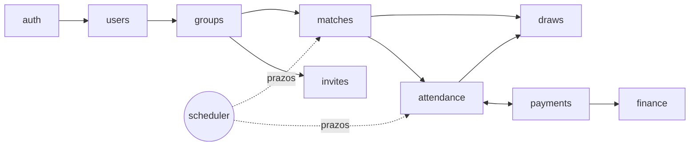

# Módulos do back-end — Dá Jogo

Organização sugerida, **independente de linguagem e framework**. Serve para dividir o trabalho, delimitar responsabilidades e evitar que regras de vaga e dinheiro fiquem espalhadas. Funciona tanto num monólito modular (recomendado para o MVP) quanto, no futuro, separado em serviços.

## Princípios

1. **Um módulo é dono dos seus dados.** Outro módulo lê por uma interface pública ou reage a eventos, nunca escreve direto nas tabelas alheias.
2. **Regras no domínio, não no controlador.** A camada HTTP só valida o formato, chama um caso de uso e traduz o resultado para o contrato.
3. **Transações curtas em vaga e dinheiro.** Toda mudança que mexe em vaga (RN-25) ou pagamento acontece numa transação, com trava por partida (lock de linha, versão otimista ou fila serial por `matchId`).
4. **Tempo é dependência.** Os casos de uso recebem um relógio injetável, para testar prazos sem esperar.
5. **Idempotência.** POSTs com `Idempotency-Key` guardam a resposta por 24 h.

## Mapa de módulos

| Módulo | Responsável por | Entidades | Endpoints (tags do OpenAPI) | Regras |
| --- | --- | --- | --- | --- |
| **auth** | Código por SMS/WhatsApp, sessão, tokens, limites de tentativa | OtpChallenge, Session | Auth | RN-01, RN-04 |
| **users** | Conta, perfil, nickname, foto, perfis esportivos, termos, exclusão | User, SportProfile | Me, Sports | RN-02, RN-03, RN-05, RN-90 a 92 |
| **groups** | Turma, regras, vínculos, permissões por turma | Group, GroupRules, Membership | Groups, Members | RN-10, 11, 14 a 16, seção 8 |
| **invites** | Códigos de convite, prévia pública, aceite | Invite | Invites | RN-12, RN-13 |
| **matches** | Ciclo de vida da partida, prazos, capacidade | Match | Matches | RN-20, 27, 40 a 43 |
| **attendance** | Presenças, vagas, lista de espera, promoção | Participation | Attendance | RN-21 a 26, 28, 30 a 32 |
| **payments** | Cobranças de avulso e mensalidade, aviso, validação | Payment | Payments | RN-24, 60 a 65 |
| **finance** | Caixa, lançamentos, resumo | LedgerEntry | Finance | RN-70, 71 |
| **draws** | Padrões de sorteio, algoritmo, ajustes, publicação | DrawTemplate, TeamDraw, Team, TeamMember | Draws | RN-50 a 55 |
| **scheduler** | Dispara eventos de prazo (vencimento de pagamento, prazo do mensalista) | — | — | RN-21, RN-24 |
| **notifications** *(fase 2)* | Push, WhatsApp, e-mail a partir dos eventos | Notification | — | — |

## Interfaces entre módulos

Chamadas síncronas, dentro do mesmo processo:

| Quem chama | Interface | Para quê |
| --- | --- | --- |
| todos | `groups.getViewer(groupId, userId)` | Papel, tipo de vínculo e permissões; base do objeto `viewer`. |
| attendance | `matches.getForUpdate(matchId)` | Lê a partida com trava antes de alocar vaga. |
| attendance | `groups.getRules(groupId)` | Prazos e promoção automática. |
| payments | `attendance.onPaymentApproved(participationId)` | Confirma o avulso na mesma transação da validação. |
| draws | `attendance.listConfirmed(matchId)` | Jogadores do sorteio, com nível e posição. |
| finance | `payments.sumReceivable(groupId)` | "A receber" do resumo. |

Eventos (podem começar como chamadas síncronas dentro da transação e virar fila depois): `MatchPublished`, `SpotReleased`, `DropInOffered`, `PaymentApproved`, `PaymentWindowExpired`, `ResponseDeadlineReached`, `ListClosed`, `TeamsPublished`, `MatchFinished` (ver domain.md › Eventos).

## Casos de uso críticos (merecem teste de unidade primeiro)

| Caso de uso | Por que é crítico |
| --- | --- |
| `respondToMatch` | Contagem de vagas, prioridade do mensalista, fila, corrida entre dois avulsos (RN-22, 23, 25). |
| `releaseSpot` (+ `promoteNext`) | Promoção automática ou manual, cadeia de expirações (RN-31). |
| `expirePaymentWindow` | Executado pelo agendador ou de forma preguiçosa; não pode expirar quem já avisou (RN-24). |
| `closeMatch` | Bloqueio por pagamentos a validar e efeitos em lote (RN-40). |
| `approvePayment` / `rejectPayment` | Vaga, caixa e prazo na mesma transação (RN-62). |
| `drawTeams` | Algoritmo e avisos (RN-52, 53). |

Cenários de aceite sugeridos (Dado/Quando/Então) para `respondToMatch`:

1. Partida com 16 vagas, 13 confirmados e 3 mensalistas `pending` → avulso diz "Quero jogar" → vai para `waitlisted` (vagas reservadas contam).
2. Mesma partida após o prazo, com `autoReleaseUnanswered = true` → 3 `expired` → fila promove os 3 primeiros (se `waitlistAutoPromote`).
3. Dois avulsos pedem a última vaga ao mesmo tempo → um `awaiting_payment`, outro `waitlisted`.
4. Avulso em `awaiting_payment` avisa o Pix 1 minuto antes do prazo → prazo vence → continua com a vaga.
5. Mensalista recusa e tenta voltar com a partida lotada → `waitlisted` no fim da fila.

## Requisitos não funcionais

| Tema | Mínimo para o MVP |
| --- | --- |
| Segurança | HTTPS; tokens de acesso curtos; renovação em cookie `HttpOnly`; limite de tentativas por IP e por telefone; CORS restrito ao domínio do app. |
| Privacidade | Telefone nunca em logs; dados pessoais fora de URLs; anonimização na exclusão (RN-91). |
| Observabilidade | Log estruturado com `requestId`; métricas de tempo por endpoint; alerta para falha no envio do código. |
| Desempenho | Leituras de partida em < 300 ms (p95); listas paginadas. |
| Fuso | Cálculo de prazos no fuso da turma; armazenamento em UTC. |
| Contrato | O `openapi.yaml` é a fonte da verdade; mudanças incompatíveis exigem nova versão (`/v2`) ou campo novo opcional. |
| Ambientes | Desenvolvimento, homologação (para o PM validar cada sprint) e produção. |

## Decisões a tomar quando a stack for escolhida

- Linguagem, framework e banco (relacional é o mais natural, pelo peso de transações de vaga e dinheiro).
- Provedor de SMS/WhatsApp para o código.
- Agendador (cron, fila com atraso ou varredura periódica) para os prazos.
- Armazenamento das fotos (bucket de objetos com URLs assinadas).
- Hospedagem e banco gerenciado.
